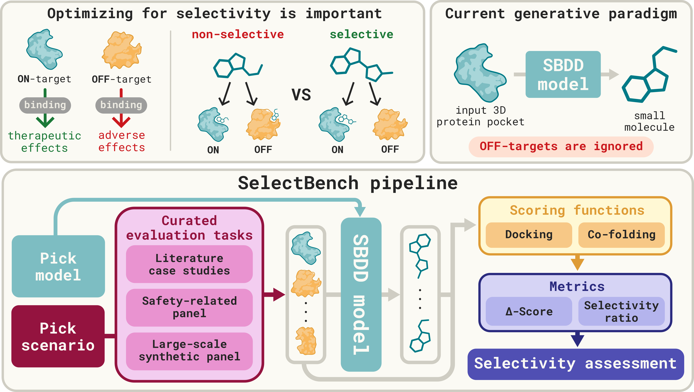

# SelectBench

Code and data for [*On the Selectivity of Generative Models in Structure-Based
Drug Design*](https://arxiv.org/abs/2610.24124) (NeurIPS 2026).

**SelectBench** evaluates whether molecules produced by structure-based
generative models bind selectively to their intended target rather than to
related off-targets. Point it at an SDF (or SMILES file) from your model and
it returns docking-based selectivity metrics across three benchmarks — case
studies, a safety-target panel, and CrossDocked pairs.



## Prerequisites

- Python ≥ 3.11 (on Ubuntu 22.04 the default `python3` is 3.10; use `pyenv`,
  `uv`, or `conda` to get 3.11)
- AutoDock Vina and Meeko — both installed automatically by `pip install -e .`
  (Vina via the [`vina`](https://pypi.org/project/vina/) Python bindings, no
  system `vina` binary required)
- Optional: [Boltz2](https://github.com/jwohlwend/boltz) for co-folding
  affinity scoring — install with `pip install -e ".[boltz2]"`
  (~5 GB extra transitives — see [`BOLTZ2.md`](BOLTZ2.md))

The full data payload (processed receptors, boxes, reference stats) ships in
this repo under `data/` — no external download required to run evaluations.

- **Hardware:** *evaluation* — the default Vina docking path — is
  **CPU-only**, and needs ~1 GB RAM per worker. An **NVIDIA GPU** is
  required only for the optional Boltz2 co-folding path and for running the
  diffusion baselines / compose generation (see
  [`baselines/README.md`](baselines/README.md)).
- **Install editable (`-e`).** The `data/` payload lives at the repo root,
  outside the package, and is read from the source tree — a non-editable
  `pip install .` ships the code without any of it. The `evaluate-*` commands
  then fail with `FileNotFoundError` on the suite's manifest CSV (`quality`,
  which needs no data, still works). Always use `pip install -e .`.

## Install

```bash
git clone https://github.com/lovetaro/selectbench.git
cd selectbench
pip install -e .                # Vina-only (fast, ~few 100 MB)
pip install -e . -c constraints.txt   # same, pinned to the versions behind our results
# or
pip install -e ".[boltz2]"      # + Boltz2 co-folding (~5 GB CUDA transitives)
```

Verify the CLI is importable:

```bash
selectbench --help
```

**Quick Test:** one can verify the full docking pipeline end-to-end on a shipped molecule 
(no generation needed — this docks a reference ligand at low search depth, ~1 min):

```bash
selectbench evaluate-case \
    --case_study parp \
    --sdf_file data/case_studies/parp/processed/VKT_ligand.sdf \
    --exhaustiveness 1 \
    --output results/_smoketest/cs/parp.csv
```

Check that the printed summary line reports `n=1/1` and that the CSV's
`score_on_target` / `score_off_target` cells hold **numbers**:

```
  [parp] n=1/1  on=-9.32  off=-9.25  Δ=-0.07  SR=1.00  SR_1kcal=0.00
```

That confirms Vina, Meeko, and the data payload are all wired up. Note the
columns alone are not enough — they are written unconditionally, and a run in
which every docking failed still **exits 0**, with empty score cells and *no
summary line at all* (the summary is only printed for molecules that scored).
What you see instead is a `Failed (...)` line per molecule, a
`[fallback:...] recovered 0/N rows` stanza, and `Results saved to ...`.

The most common cause is memory: the dock peaks at ~600 MB, and with under
~1 GB available the Vina subprocess is killed (exit 137) and you get exactly
that empty CSV. Check the limit that actually applies to your process, not the
machine's total — under SLURM or in a container, `free` reports the node's
memory while your job is capped far lower:

```bash
cat /sys/fs/cgroup/memory.max          # cgroup v2; "max" means unlimited
scontrol show job "$SLURM_JOB_ID" | grep -i mem   # under SLURM
```

## Repository layout

| Path | What's here |
|---|---|
| [`data/`](data/README.md) | The three benchmark suites (receptors, pockets, boxes, pair manifests) + Z-score reference library + the ["using these targets with your own model"](data/README.md#using-these-targets-with-your-own-model) guide |
| `src/selectbench/` | The docking core + the `selectbench` CLI |
| [`scripts/`](scripts/README.md) | Batch wrapper on CLI (`run_eval.py`), generation wrappers ([`generate_compose/`](scripts/generate_compose/README.md)), and selectivity metrics calculation ([`summarize/`](scripts/summarize/README.md)) |
| [`baselines/`](baselines/README.md) | Per-baseline setup/README + compose patches for the 3 diffusion baselines |
| [`results/`](results/README.md) | Output schema + metric glossary |
| `generated_samples/` | Where you drop your model's SDF/SMILES for evaluation; **git-ignored** — you create it |

## Data

`data/` holds the **three benchmark suites** (case studies, Safety, CrossDocked) — laid out across **four** target-set directories, because Safety spans two (`standard_docking_benchmark/` for the on-target PoIs and `safety_targets/` for the shared anti-target panel) — plus a precomputed Z-score reference library. 
Full details in [`data/README.md`](data/README.md).

Quick pointers:

| Set | CSV |
|---|---|
| Case studies | `data/case_studies/case_studies.csv` |
| Safety on-targets (PoIs) | `data/standard_docking_benchmark/standard_docking_benchmark.csv` |
| Safety anti-targets | `data/safety_targets/safety_targets.csv` |
| CrossDocked pairs | `data/crossdocked_test_set/crossdocked_test_set_pairs.csv` |
| Z-score reference stats | `data/zscore_library/processed/*.csv` |

Re-processing the raw PDBs is optional — the shipped `processed/` files
under each set are sufficient to run every evaluation. If you do need to
re-run preparation, also clone `geostd` outside this repo and set
`MMTBX_CCP4_MONOMER_LIB`:

```bash
git clone https://github.com/phenix-project/geostd.git /path/to/geostd
export MMTBX_CCP4_MONOMER_LIB=/path/to/geostd
```

Re-processing additionally shells out to `mmtbx.reduce2` (for hydrogen
placement), which ships with **CCTBX/Phenix** and is not installed by
`pip install -e .`. Install it separately before re-running preparation.

Each prep script expects to be run from its own `raw/` directory. Beyond
that they differ:

| Script | Downloads structures from RCSB | Fetches sequences from RCSB | Rewrites its manifest |
|---|---|---|---|
| `data/case_studies/<case>/raw/process_pdbs.py` | no (reads the shipped `raw/*.pdb`) | yes | yes |
| `data/standard_docking_benchmark/raw/process_pdbs.py` | yes (skips any PDB already present) | yes | yes |
| `data/safety_targets/raw/process_pdbs.py` | yes (skips any PDB already present) | no (block commented out) | no |
| `data/crossdocked_test_set/raw/process_pdbs.py` | no | no | no |

Since every raw PDB ships in this repo, the download loops no-op in a fresh
checkout and only the sequence fetches actually reach the network. Note that
re-running the CrossDocked prep overwrites tracked files under its own `raw/`
tree.

## Using Selectbench CLI

The `selectbench` CLI has the following commands. All are documented in `selectbench <cmd> --help`; a quick tour:

| Command | Purpose |
|---|---|
| `evaluate-case` | Dock an SDF/SMILES file against one case study's on/off pair. |
| `evaluate-safety` | Dock against all safety targets (± an on-target). |
| `evaluate-xl` | Dock against one CrossDocked oriented `(on, off)` pair. |
| `check-safety` | Quick Vina check: one SMILES vs the safety panel. |
| `check-crossdocked` | Quick Vina check: one SMILES vs one CrossDocked pair. |
| `check-boltz2` | Boltz2 affinity for one SMILES against a case study's two receptors. |
| `compute-reference-stats` | Regenerate the Z-score reference library. |
| `quality` | Reference-free molecular-quality metrics (QED, SA, LogP, Lipinski, MW, Diversity) for a SMILES/SDF file — no docking. |

- `selectbench evaluate-*` commands generate per-mol raw CSVs. For `cs/` and
  `crossdocked/` these hold just the raw docking scores and their delta; the
  safety CSVs additionally carry `mean_safety_score`, `delta_mean`, and
  `is_top20` (full schema in [`results/README.md`](results/README.md)). 
- These raw csvs can then be used to calculate selectivity metrics *on demand* by `scripts/summarize/cross_method.py`. See [`summarize/`](scripts/summarize/README.md)
- The same summarizer can additionally append **molecular-quality columns** with `--quality` (opt-in; off by default). See [`results/README.md`](results/README.md) for the full column schema.

### Input format

Every `selectbench evaluate-*` command takes your molecules as **either** an SDF or a SMILES file (not both):

- **`--sdf_file <path.sdf>`** — a multi-molecule SDF. Records RDKit can't parse
  are skipped before docking (no row emitted), so `mol_idx` (the record's
  original position) may have gaps.
- **`--smiles_file <path.smi>`** — one SMILES per line, treated **verbatim**.
  This is *not* a CSV: no header row and no `smiles,id` column — either would be
  parsed as an (invalid) SMILES. Blank lines are ignored.
- A molecule that parses but then fails Meeko prep or docking still gets a row, with empty (NaN) score cells — so `n_valid / n_total` is the docking-success rate among inputs that entered the loop (only unparseable SDF records are dropped outright). 

### Batch pipeline (what we used for the paper)
> **NOTE**: The CLI is the tool; `scripts/run_eval.py` is the batch layer over it.
> 
> It auto-discovers every `generated_samples/<method>/<benchmark_type>/*.sdf` (and `*.smi`), 
> picks the matching subcommand `selectbench evaluate-*` to directly score a single file, 
> and writes to `results/<method>/<benchmark_type>/` for the many-files/many-methods sweep. 
> Same docking core, same exhaustiveness defaults, same fallback behavior.

Each of the three benchmark types (`cs/`, `safety/`, `crossdocked/`) shares the same **generate → evaluate → summarize** shape and the same 
`{generated_samples,results}/<method>/{cs,safety,crossdocked}/` file layout (canonical schema in [`results/README.md`](results/README.md)). 
Below we illustrate this three-command loop against a case study, producing `results/summary/cs/<case>.csv`:

```bash
# 1. Drop a molecule set into the expected layout.
#    For a purely demo purpose, simply seed it from a shipped ligand (e.g., data/case_studies/parp/processed/VKT_ligand.sdf); 
#    for a real run, replace this cp with your own model output (same path/name).
mkdir -p generated_samples/<method>/cs
cp <molecules.sdf> generated_samples/<method>/cs/<case>.sdf

# 2. Evaluate (auto-discovers all methods under generated_samples/*/)
#    Paper protocol per suite: case=20, crossdocked=10, safety=1 (these are
#    the defaults for both run_eval.py and the `selectbench evaluate-*` CLI).
#    Override with `--exhaustiveness <N>` for a faster smoke test 
#    (N=1 is the cheapest; scores get noisier as N drops).
python scripts/run_eval.py --method <method> --eval cs

# 3. Cross-method summary (rows = methods, cols = metrics)
python scripts/summarize/cross_method.py --mode cs
# → results/summary/cs/<case>.csv
```

Swap `--eval cs` for `safety` or `crossdocked` and use the matching input
layout — see [`data/README.md`](data/README.md#3-name-your-output-so-eval-finds-it)
for the full three-bucket file convention.

For per-baseline generation setup, batch dispatchers, filename conventions, and the compose (selectivity-guided) pipeline, see:

- [`scripts/README.md`](scripts/README.md) — `run_eval.py`, `hardest_safety_targets.py`, and the full flag reference
- [`scripts/generate_compose/README.md`](scripts/generate_compose/README.md) — compose flags + negative-guidance pipeline
- [`scripts/summarize/README.md`](scripts/summarize/README.md) — cross-method aggregation, z-scores, `--score_fn boltz2`
- [`baselines/README.md`](baselines/README.md) — per-baseline setup and the compose reproduction wrappers
- [`data/README.md`](data/README.md#using-these-targets-with-your-own-model) — **"Using these targets with your own model"**: input pockets for on-target-only *and* selective on/off generation, target enumeration, and output-file naming

## Bring your own model

SelectBench needs none of the shipped baselines. For every target it provides
the **input pocket(s)** you condition your generator on, then docks whatever
molecules you produce against the benchmark's fixed **on-/off-target pair(s)** —
the same selectivity metrics apply however the molecules were made, whether you
generate on-target-only or steer selectively against the off-target.

Everything specific to feeding your model — the on-/off-target pocket and
reference-ligand paths, which side is "on", target enumeration, and how to name
each output file so the evaluator finds it — is documented in one place:
[**data/README.md → "Using these targets with your own model"**](data/README.md#using-these-targets-with-your-own-model).

Once your `.sdf`/`.smi` files are named and in place, evaluate them exactly as
shown above — one file with a `selectbench evaluate-*` command (see
[Using Selectbench CLI](#using-selectbench-cli)), or many files/methods at once
with the [batch pipeline](#batch-pipeline-what-we-used-for-the-paper).

## Reproducibility

Docking scores are deterministic for a fixed software stack. Two sources of
randomness are pinned to fixed seeds:

| Env var | Default | What it seeds |
|---|---|---|
| `SELECTBENCH_EMBED_SEED` | `42` | RDKit ETKDG conformer generation (`ligand_prep.py`) |
| `SELECTBENCH_DOCK_SEED` | `42` | Vina's Monte Carlo search (`dock.py`) |

Re-running the same command on the same input with the same library versions
therefore reproduces the same CSV byte-for-byte; `constraints.txt` pins the
versions we used (`pip install -e . -c constraints.txt`). Override either
variable to run a seed sweep.

Caveats:

- **Determinism holds at `cpu=1`**, which is the default. Vina's own threads
  race above that, so scores drift with `cpu>1` regardless of seed. Parallelism
  via `--nproc` is unaffected — it distributes *molecules* across workers, each
  still running Vina single-threaded.
- A docking that exceeds `SELECTBENCH_DOCK_TIMEOUT` is retried at the fallback
  exhaustiveness, which depends on machine load rather than the seed. In
  case-study and CrossDocked output the per-molecule `exhaustiveness` column
  records which rows were affected.
- Scores produced before seeds were pinned are not reproducible and will not
  match current output exactly. Vina's search is stochastic, so those runs did
  not reproduce each other either.

### Generated molecules

The molecules behind the paper's results are on
[OSF](https://osf.io/mwty2/overview?view_only=d1cd4c24de004a1fb8d62a61ee581399),
one zip per benchmark suite. To re-score a method, copy e.g.
`cs_smiles/<method>/` to `generated_samples/<method>/cs/` (likewise for `safety`
and `crossdocked`) and run the
[batch pipeline](#batch-pipeline-what-we-used-for-the-paper), installing with
`-c constraints.txt` to match our docking stack.

## Citation

If you use SelectBench — the code, the benchmark data, or both — please cite
our paper:

```bibtex
@misc{rajaonson2026selectivitygenerativemodelsstructurebased,
      title={On the Selectivity of Generative Models in Structure-Based Drug Design}, 
      author={Ella Miray Rajaonson and Jungyoon Lee and William Chau and Alan Aspuru-Guzik and Benjamin Sanchez-Lengeling and Dominique Beaini and Kirill Neklyudov and Marta Skreta},
      year={2026},
      eprint={2610.24124},
      archivePrefix={arXiv},
      primaryClass={cs.LG},
      url={https://arxiv.org/abs/2610.24124}, 
}
```

To cite the software itself:

```bibtex
@software{selectbench,
  title    = {SelectBench: a selectivity benchmark for structure-based generative models},
  author   = {Lee, Jungyoon and Rajaonson, Ella and Skreta, Marta},
  year     = {2026},
  version  = {0.1.0},
  url      = {https://github.com/lovetaro/selectbench},
  license  = {MIT}
}
```

Machine-readable metadata is in [`CITATION.cff`](CITATION.cff).

Individual case studies additionally derive from their source publications
(referenced by the `_jcim` / `_jmed` folder suffixes in `data/case_studies/`);
please cite those where relevant. The CrossDocked suite derives from
CrossDocked2020, and the on-target PoI set from MOOD — see each suite's
`croissant.json` for full provenance.

## Guidelines 

We provide general usage guidelines of SelectBench to ensure future fair use:

- **A fixed, capped sample budget**. Top-k metrics reward generating an enormous batch and reporting only the best few, so a method can appear strong simply by sampling more. To remove this degree of freedom, future methods evaluated on SelectBench should generate no more than 100 valid molecules per target, with metrics reported over that fixed budget rather than as a best-of-N. This closes the oversample-and-cherry-pick strategy and places every method on equal footing at equal budget, so differences reflect the method and not the sample count.
- **Multi-objective reporting.** Selectivity is just one aspect of the drug design process. We therefore recommend reporting selectivity and on-target affinity jointly, alongside the regular suite of SBBD metrics so that any gain is legible against its cost on the other axes (e.g. selectivity bought with a large drop in synthesizability is visible rather than hidden).
- **Overfitting and novelty controls.** 
  - **A. Similarity to known inhibitors.** Because the benchmark targets are public, a benchmark-aware method could score well by effectively reproducing known, published binders rather than by generalizing. We therefore suggest reporting the Tanimoto similarity of generated molecules to known inhibitors of each target, so that a method which mostly rediscovers existing chemotypes is made visible rather than rewarded as novel design. 
  - **B. Disclosing fine-tuning on the benchmark targets.** Fine-tuning, specifically on SelectBench-Case or on their known ligands, should be explicitly disclosed. Such a method is not disqualified, but it must be reported as target-specific tuning so that in-distribution performance is not conflated with zero-shot generalization, which is what the benchmark is meant to measure.

## License

SelectBench's code is MIT-licensed; the benchmark data under `data/` is
[CC BY 4.0](https://creativecommons.org/licenses/by/4.0/). Some baseline
directories vendor third-party code under their own terms — notably
`baselines/decompdiff/compose_patch/`, which is **CC BY-NC 4.0
(non-commercial)** and is therefore *not* covered by the MIT grant. See
[`LICENSE`](LICENSE) for the full component list.

## Notes
### Alternative scoring: Boltz2

Instead of Vina docking, selectivity can be scored with Boltz2 co-folding
affinity probability. See [`BOLTZ2.md`](BOLTZ2.md) for install and usage;
the summary side is `python scripts/summarize/cross_method.py --score_fn boltz2`.

### Selectivity-guided (compose) generation

We provide a *guidance framework* for three diffusion baselines benchmarked in the paper (DiffSBDD, TargetDiff, DecompDiff) — users who simply want to test their own model and/or generated molecules can skip this section entirely. See [`scripts/generate_compose/README.md`](scripts/generate_compose/README.md) for more details.